# Diagrama de clases

Corresponde al código de la fase 6 (paquete raíz `co.edu.uniquindio.fintech`). Para que
sea legible se muestran los miembros principales; los DTO se agrupan en una nota y los
enums del modelo solo por nombre. Relaciones: `<|--` herencia, `<|..` implementa una
interfaz, `-->` dependencia/asociación, `*--` composición.

```mermaid
classDiagram
direction LR

%% ===================== structures =====================
namespace structures_interfaces {
  class Coleccion~T~ { <<interface>> +tamanio() int +estaVacia() boolean +limpiar() }
  class Lista~T~ { <<interface>> +agregar(T) +obtener(int) T +eliminar(T) boolean }
  class Pila~T~ { <<interface>> +apilar(T) +desapilar() T +cima() T }
  class Cola~T~ { <<interface>> +encolar(T) +desencolar() T +frente() T }
  class ColaPrioridad~T~ { <<interface>> +insertar(T) +extraer() T +consultar() T }
  class TablaHash~K,V~ { <<interface>> +poner(K,V) V +obtener(K) V +eliminar(K) V +claves() Lista }
  class ArbolBinarioBusqueda~K,V~ { <<interface>> +insertar(K,V) +buscar(K) V +inOrden() Lista +rango(K,K) Lista +mayores(int) Lista }
  class GrafoDirigidoPonderado~V~ { <<interface>> +incrementarPeso(V,V,BigDecimal) +rutaMenosSaltos(V,V) Lista +rutaMenorPeso(V,V) Lista +tieneCiclo() boolean +ciclosQueIncluyen(V,int) Lista }
  class Comparador~T~ { <<interface>> +comparar(T,T) int }
  class ClaveCompuesta~P,D~ { +principal() P +desempate() D }
  class Arista~V~ { <<record>> origen V destino V peso BigDecimal }
}
namespace structures_propias {
  class ListaEnlazada~T~
  class ArbolBinarioBusquedaImpl~K,V~
  class GrafoDirigidoPonderadoImpl~V~
}
namespace structures_adaptadores {
  class PilaAdaptador~T~
  class ColaAdaptador~T~
  class ColaPrioridadAdaptador~T~
  class TablaHashAdaptador~K,V~
}
Coleccion <|-- Lista
Coleccion <|-- Pila
Coleccion <|-- Cola
Coleccion <|-- ColaPrioridad
Lista <|.. ListaEnlazada
Pila <|.. PilaAdaptador
Cola <|.. ColaAdaptador
ColaPrioridad <|.. ColaPrioridadAdaptador
TablaHash <|.. TablaHashAdaptador
ArbolBinarioBusqueda <|.. ArbolBinarioBusquedaImpl
GrafoDirigidoPonderado <|.. GrafoDirigidoPonderadoImpl
ColaPrioridadAdaptador --> Comparador
GrafoDirigidoPonderado --> Arista

%% ===================== model =====================
namespace model {
  class Usuario { <<record>> identificacion nombre correo puntosAcumulados long nivel NivelUsuario }
  class Billetera { <<record>> codigo identificacionPropietario nombre tipo TipoBilletera saldo BigDecimal estado EstadoBilletera }
  class Transaccion { <<record>> id fecha tipo TipoTransaccion valor BigDecimal billeteraOrigen billeteraDestino estado EstadoTransaccion puntosGenerados nivelRiesgo NivelRiesgo transaccionRevertida +esReversion() boolean }
  class OperacionProgramada { <<record>> id tipo TipoOperacionProgramada valor fechaEjecucion periodicidad Periodicidad estado }
  class Notificacion { <<record>> id identificacionUsuario tipo TipoNotificacion mensaje fecha estado }
  class EventoAuditoria { <<record>> id identificacionUsuario transaccion patron PatronInusual descripcion nivelRiesgo fecha }
  class BeneficioCanjeado { <<record>> id identificacionUsuario beneficio puntosDescontados fecha estado }
  class NivelUsuario { <<enumeration>> BRONCE PLATA ORO PLATINO }
}

%% ===================== persistence =====================
namespace persistence {
  class AlmacenJson~T~ { <<interface>> +cargar() Lista +guardar(Lista) }
  class AlmacenJsonArchivo~T~
  class AlmacenesJson
  class EscrituraAtomica
  class DiarioOperaciones { <<interface>> +preparar(String, Object...) EntradaDiario +ejecutar(EntradaDiario, Runnable) +recuperarPendientes() int +pendientes() Lista }
  class DiarioOperacionesJson
  class EntradaDiario { <<record>> }
  class ImagenRegistro { <<record>> archivo identificador contenido }
  class GeneradorIdentificadores { +siguiente(TipoIdentificador) String }
  class VerificadorIntegridad
  class CerrojoEscritura
}
AlmacenJson <|.. AlmacenJsonArchivo
AlmacenJsonArchivo --> EscrituraAtomica
AlmacenesJson *-- AlmacenJsonArchivo
DiarioOperaciones <|.. DiarioOperacionesJson
DiarioOperacionesJson --> AlmacenesJson
DiarioOperacionesJson --> CerrojoEscritura
EntradaDiario *-- ImagenRegistro

%% ===================== repository =====================
namespace repository {
  class FabricaEstructuras { <<interface>> +nuevaLista() +nuevaPila() +nuevaCola() +nuevaColaPrioridad(Comparador) +nuevaTablaHash() +nuevoArbol() +nuevoGrafo() }
  class RepositorioEnMemoria~T~ { <<abstract>> #porIdentificador TablaHash #orden Lista +buscar(String) T +todos() Lista +reflejar(T) }
  class RepositorioUsuarios { -porPuntos ArbolBinarioBusqueda +ordenadosPorPuntos() Lista +porRangoDePuntos(long,long) Lista }
  class RepositorioBilleteras { -porPropietario IndicePorClave +propietarioDe(String) String }
  class RepositorioTransacciones { -porValor ArbolBinarioBusqueda +reconstruirPilaReversibles(String, CriterioReversion) Pila +construirGrafoTransferencias(CriterioPesoTransferencia) GrafoDirigidoPonderado }
  class RepositorioOperacionesProgramadas { -pendientes ColaPrioridad +siguientePendiente() OperacionProgramada }
  class RepositorioNotificaciones { -colaPendientes Cola +siguientePendiente() Notificacion +recientes(String) Lista }
  class RepositorioAuditoria
  class RepositorioBeneficios
  class IndicePorClave
  class CriterioReversion { <<interface>> +esReversible(Transaccion) boolean }
  class CriterioPesoTransferencia { <<interface>> +peso(Transaccion,String,String) BigDecimal }
}
RepositorioEnMemoria <|-- RepositorioUsuarios
RepositorioEnMemoria <|-- RepositorioBilleteras
RepositorioEnMemoria <|-- RepositorioTransacciones
RepositorioEnMemoria <|-- RepositorioOperacionesProgramadas
RepositorioEnMemoria <|-- RepositorioNotificaciones
RepositorioEnMemoria <|-- RepositorioAuditoria
RepositorioEnMemoria <|-- RepositorioBeneficios
RepositorioEnMemoria --> AlmacenJson
RepositorioEnMemoria --> FabricaEstructuras
RepositorioEnMemoria --> TablaHash
RepositorioUsuarios --> ArbolBinarioBusqueda
RepositorioTransacciones --> ArbolBinarioBusqueda
RepositorioTransacciones --> Pila
RepositorioTransacciones --> GrafoDirigidoPonderado
RepositorioOperacionesProgramadas --> ColaPrioridad
RepositorioNotificaciones --> Cola
RepositorioUsuarios --> Usuario
RepositorioTransacciones --> Transaccion

%% ===================== service =====================
namespace service {
  class EscrituraConDiario { +asegurarSinPendientes() +ejecutar(String, Object[]) }
  class ActualizadorMemoria { +reflejar(Object[]) }
  class UsuarioService
  class BilleteraService
  class TransaccionService { +recargar() +retirar() +transferir() +revertir(String) +revertirUltima(String) +ejecutarProgramada() }
  class OperacionProgramadaService { +programar() +procesarVencidas() Lista +cancelar(String) }
  class NotificacionService { +crear() +despacharPendientes() Lista }
  class DeteccionService { +analizar(Transaccion,String) Lista +eventos(NivelRiesgo) Lista }
  class PuntosService { +calcular() long +nivelPara(long) NivelUsuario +ajustar(Usuario,long) Usuario }
  class RecompensaService { +canjear(String,String) BeneficioCanjeado }
  class AnaliticaService
  class GrafoService { +rutas() +relacionesFrecuentes() +ciclosQueIncluyen() }
  class PoliticaReversion
  class PoliticaPuntos { <<record>> }
  class PoliticaDeteccion { <<record>> }
  class PoliticaNotificaciones { <<record>> }
  class PoliticaProgramacion { <<record>> }
  class CatalogoBeneficios
}
CriterioReversion <|.. PoliticaReversion
EscrituraConDiario --> DiarioOperaciones
EscrituraConDiario --> ActualizadorMemoria
UsuarioService --> RepositorioUsuarios
UsuarioService --> EscrituraConDiario
BilleteraService --> RepositorioBilleteras
BilleteraService --> UsuarioService
TransaccionService --> RepositorioTransacciones
TransaccionService --> RepositorioBilleteras
TransaccionService --> EscrituraConDiario
TransaccionService --> PuntosService
TransaccionService --> DeteccionService
TransaccionService --> NotificacionService
TransaccionService --> PoliticaReversion
OperacionProgramadaService --> RepositorioOperacionesProgramadas
OperacionProgramadaService --> TransaccionService
OperacionProgramadaService --> PoliticaProgramacion
NotificacionService --> RepositorioNotificaciones
DeteccionService --> PoliticaDeteccion
DeteccionService --> RepositorioAuditoria
PuntosService --> PoliticaPuntos
RecompensaService --> CatalogoBeneficios
RecompensaService --> RepositorioBeneficios
AnaliticaService --> RepositorioTransacciones
GrafoService --> RepositorioTransacciones
AnaliticaService --> ColaPrioridad

%% ===================== controller / benchmark / config =====================
namespace controller {
  class UsuarioController
  class BilleteraController
  class TransaccionController
  class OperacionProgramadaController
  class RecompensaController
  class NotificacionAuditoriaController
  class AnaliticaController
}
namespace benchmark {
  class BenchmarkEstructuras { +ejecutar(ComparacionBenchmark,int,int) Lista }
  class MedicionBenchmark { <<record>> }
}
namespace exception {
  class FintechException { <<abstract>> +codigo() String }
  class RecursoNoEncontradoException
  class ConflictoNegocioException
  class SolicitudInvalidaException
  class PersistenciaException
  class ManejadorGlobalExcepciones
}
namespace config {
  class ConfiguracionPersistencia
  class ConfiguracionNegocio
  class ConfiguracionReloj
  class InicializadorDatos
  class ContextoDatos
  class FabricaEstructurasPropias
  class EjecucionAutomaticaProgramadas
}
UsuarioController --> UsuarioService
BilleteraController --> BilleteraService
TransaccionController --> TransaccionService
OperacionProgramadaController --> OperacionProgramadaService
RecompensaController --> RecompensaService
NotificacionAuditoriaController --> NotificacionService
NotificacionAuditoriaController --> DeteccionService
AnaliticaController --> AnaliticaService
AnaliticaController --> GrafoService
AnaliticaController --> BenchmarkEstructuras
BenchmarkEstructuras --> MedicionBenchmark
BenchmarkEstructuras --> TablaHashAdaptador
BenchmarkEstructuras --> ArbolBinarioBusquedaImpl
BenchmarkEstructuras --> ListaEnlazada
BenchmarkEstructuras --> ColaPrioridadAdaptador
BenchmarkEstructuras --> GrafoDirigidoPonderadoImpl
FintechException <|-- RecursoNoEncontradoException
FintechException <|-- ConflictoNegocioException
FintechException <|-- SolicitudInvalidaException
FintechException <|-- PersistenciaException
ManejadorGlobalExcepciones --> FintechException
FabricaEstructuras <|.. FabricaEstructurasPropias
FabricaEstructurasPropias --> ListaEnlazada
FabricaEstructurasPropias --> ArbolBinarioBusquedaImpl
FabricaEstructurasPropias --> GrafoDirigidoPonderadoImpl
FabricaEstructurasPropias --> PilaAdaptador
FabricaEstructurasPropias --> ColaAdaptador
FabricaEstructurasPropias --> ColaPrioridadAdaptador
FabricaEstructurasPropias --> TablaHashAdaptador
InicializadorDatos --> ContextoDatos
InicializadorDatos --> VerificadorIntegridad
InicializadorDatos --> DiarioOperaciones
ConfiguracionPersistencia --> InicializadorDatos
ConfiguracionNegocio --> EscrituraConDiario
EjecucionAutomaticaProgramadas --> OperacionProgramadaService
```

## DTO (paquete `dto`, todos `record`)

| Solicitudes (con Bean Validation) | Respuestas |
|---|---|
| `SolicitudRegistroUsuario`, `SolicitudActualizacionUsuario`, `SolicitudCreacionBilletera`, `SolicitudActualizacionBilletera`, `SolicitudRecarga`, `SolicitudRetiro`, `SolicitudTransferencia`, `SolicitudOperacionProgramada`, `SolicitudCanje` | `UsuarioRespuesta`, `PuntosRespuesta`, `BilleteraRespuesta`, `SaldoRespuesta`, `TransaccionRespuesta`, `OperacionProgramadaRespuesta`, `ResultadoEjecucionRespuesta`, `ProcesamientoRespuesta`, `NotificacionRespuesta`, `EventoAuditoriaRespuesta`, `NivelRespuesta`, `BeneficioCatalogoRespuesta`, `BeneficioCanjeadoRespuesta`, `ConteoRespuesta`, `MontoMovilizadoRespuesta`, `GrafoRespuesta`, `AristaRespuesta`, `RutaRespuesta`, `CiclosRespuesta`, `BenchmarkRespuesta`, `MedicionBenchmarkRespuesta`, `RespuestaError` |

Los controladores reciben solicitudes, llaman a un servicio y convierten el resultado
(`Lista` de `structures`) en arreglos de respuestas. Ningún controlador accede a
`repository` ni a `persistence` (lo verifica `ArquitecturaTest`).

Enums del modelo: `TipoBilletera`, `EstadoBilletera`, `TipoTransaccion`, `EstadoTransaccion`,
`TipoOperacionProgramada`, `Periodicidad`, `EstadoOperacionProgramada`, `TipoNotificacion`,
`EstadoNotificacion`, `NivelUsuario`, `NivelRiesgo`, `PatronInusual`, `EstadoCanje`.
